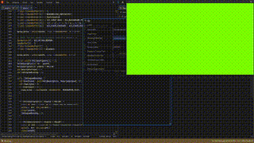

# No Dep Window

 No Dependency Window is as the name describes it's an application without any includes directives or libc. 
 Currently the only platform this works on is on Linux plus X11. However, in the future
 this will probably include every single major operation system like Linux Distros, Windows, and Macos.

 The reason this only includes Linux Distros using X11 for that matter is because Linux Windowing services are 
 typically done through an underlying Unix socket with the same being true for Wayland. Meaning external
 code like setting up a window class or creating the window proper are done over the wire.

 However with windows and macos this becomes less trivial as It would become necessary to start loading
 DLLs which with the limitation of not using include directives or libc because kind of non trivially hard.
 So It has been left out for the time being.

# What the application looks like

  >The application is a rainbow gradient using an HSV to RGB conversion function. It's 
  >Simplistic enough that you could implement this anywhere \o/

# How to build

  If for some reason you find yourself wanting to build and run this application that was
  made for demonstration purposes I have included a makefile.
  
  It runs using gcc so make sure you have a version of that and also make.
